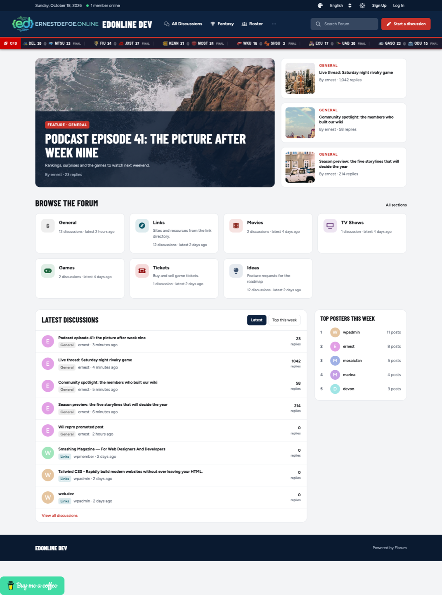
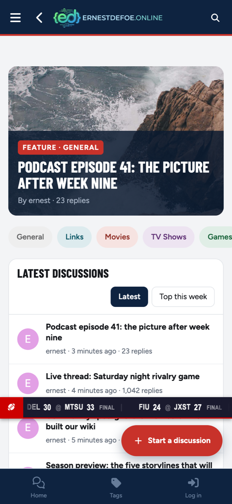
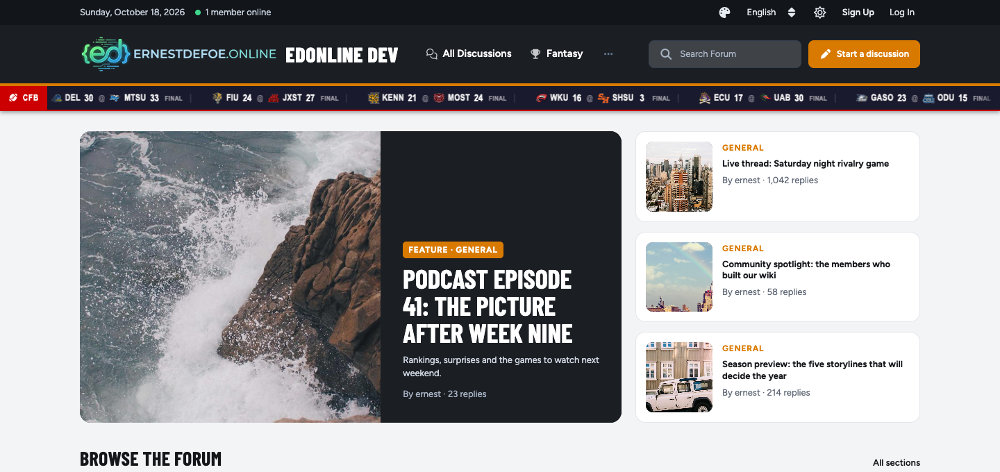
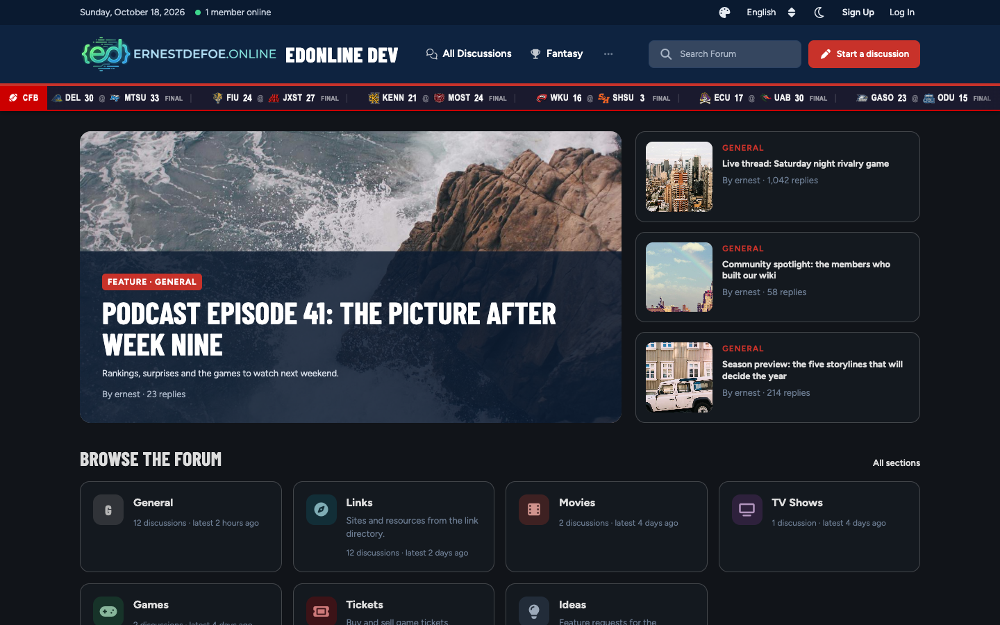

# Masthead

**A portal theme for Flarum 2**, in the style of an IPS 5 or XenForo UI.X
front page. A navy masthead with a utility strip, a featured story with three
beside it, a grid of the forum's sections, the latest discussions and a
sidebar of widgets, on a grey ground of white cards.



---

## What it does

- **A masthead.** A utility strip with today's date, how many members are
  online and the visitor's own controls; then the logo or a monogram tile,
  the forum's name and a tagline, the main navigation, search and
  **Start a discussion**, with an accent rule underneath.
- **A portal home page.** The forum's front page becomes the portal; the
  discussion list moves to `/all`. Prefer the list? One setting puts it back.
- **Featured stories.** One feature and three side stories, with pictures
  taken from each opening post (Markdown, BBCode or fof/upload images). Stories
  come from the newest discussions, a tag, sticky discussions or Page Builder
  articles.
- **Browse the forum.** A tile for each top-level tag, with its icon,
  description, discussion count and latest activity.
- **Latest discussions** and **Top this week**, with coloured tag chips.
- **Widgets.** *Top posters this week*, and *Upcoming games* when
  [Picks](https://github.com/ernestdefoe/picks) is installed. Top posters can
  also be placed anywhere through Bespoke or fof/forum-widgets-core.
- **A footer** with your own links.
- **Phones** get a compact bar, the feature card, a scrolling row of section
  chips, the latest list and a floating **Start a discussion**.
- **Dark mode**, following Flarum's own light, dark and high-contrast modes.



---

## Presets

Pick a look in one click. A preset sets the accent, the masthead colour, the
featured-story layout and the corners together:

| Preset | Look |
|---|---|
| **Game Day** | Navy and red, full-width feature |
| **Sunday** | Charcoal and orange, split feature |
| **Evergreen** | Forest green, full-width feature |
| **Royal** | Midnight and purple, full-width feature |
| **Broadsheet** | Black and red, square corners, split feature |

Then change only what you want. The accent can be red, orange, green, purple,
Flarum's own primary colour or any colour you choose; the masthead can take any
colour; the feature can be full width, split or off. Your changes stay when you
switch presets.





---

## Settings

| Setting | What it does |
|---|---|
| **Home page** | The portal or the discussion list. The same setting as *Home page* in Basics. |
| **Preset**, **Accent colour**, **Masthead colour** | The look, above. |
| **Tagline**, **Monogram**, **Show the forum name beside the logo** | The title block. The logo is Flarum's own (Appearance → Logo). |
| **Use the theme's fonts** | Barlow Condensed and Figtree, served from your forum. Off uses system fonts. |
| **Layout**, **Stories from**, **Tag** / **Content type** | The featured stories. |
| **Sections in the grid** | How many tags *Browse the forum* shows. |
| **Footer links**, **Show "Powered by Flarum"** | The footer. Drag links to reorder. |

---

## Works with

All optional. Masthead checks for each one and does without it.

- **flarum/tags**: the section grid, tag chips and a tag as the story source.
- **flarum/sticky**: sticky discussions as the story source.
- **fof/upload**: its images are used as story pictures.
- **ernestdefoe/page-builder**: articles as the story source.
- **ernestdefoe/header-nav**: when installed, it decides what the main navigation holds.
- **ernestdefoe/backdrop**: an author's profile cover is the picture of last resort.
- **ernestdefoe/picks**: the upcoming-games card.
- **ernestdefoe/bespoke**, **fof/forum-widgets-core**: place *Top posters* in their zones.
- **ernestdefoe/wardrobe**: offer Masthead as one of several themes members can choose.

---

## Light by design

- **forum.js**: 16.5 KB (5.4 KB gzipped), the whole theme including the portal.
- **Stylesheet**: about 22 KB (4.6 KB gzipped) added to the forum's CSS.
- **The portal page** runs 14 database queries in total on a forum with 60+
  extensions enabled, and the same with 7 tags or 32. Masthead's own share is five
  for the featured stories. The top-posters list and the online count are
  cached (10 minutes and 1 minute).
- **Fonts** are served from your own forum, never from Google, and only the
  latin subset loads unless a page needs more.
- Tested with a **database table prefix** on MariaDB, PostgreSQL and
  SQLite.

---

## Install

```bash
composer require ernestdefoe/masthead
php flarum cache:clear
```

Enable **Masthead** in the admin panel. The portal becomes the home page unless
you had already chosen a home page other than the discussion list.

## Update

```bash
composer update ernestdefoe/masthead
php flarum cache:clear
```

---

## Translations

Every word on screen is in `locale/en.yml`, ready for a language pack.

## Licence

MIT. The bundled fonts, Barlow Condensed and Figtree, are under the SIL Open
Font License (`assets/fonts/`).

☕ If you like the things I have built, consider [buying me a coffee](https://buymeacoffee.com/ernestdefoe).
